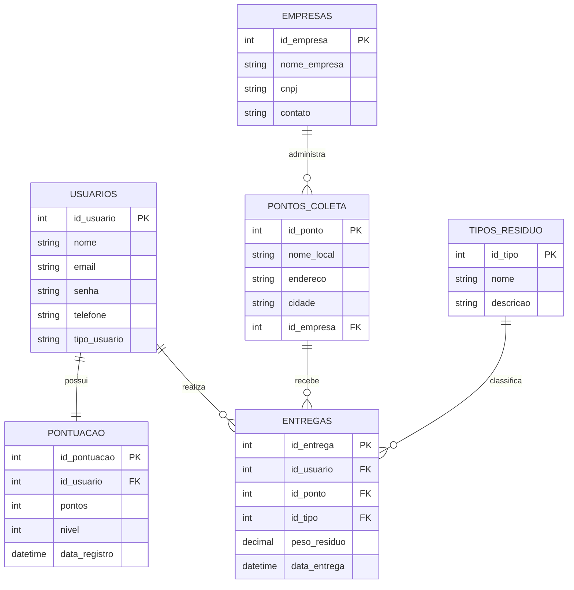

# E-Cycle — Modelo Conceitual (DER)

Diagrama Entidade-Relacionamento do E-Cycle. Renderiza direto no GitHub.

## Regras de negócio atendidas

- Um usuário pode realizar **várias entregas** (1:N).
- Uma empresa administra **vários pontos de coleta** (1:N).
- Um ponto de coleta recebe **vários resíduos** (várias entregas).
- Cada entrega gera **pontuação** (gamificação).
- O sistema guarda o **histórico** de todas as entregas.
