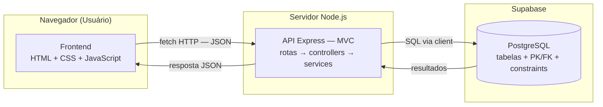
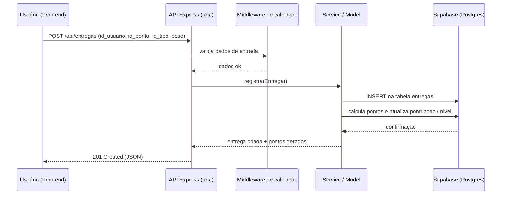

# E-Cycle — Plano do Projeto

> **Documento de planejamento** — fluxo, arquitetura de software, cronograma e forma de avaliação.
> Destino no repositório: `docs/PLANO.md`.

## Contexto

| Item | Definição |
|---|---|
| **Escola** | E.E. José Domingos da Silveira |
| **Turma** | 3º A — DS (Desenvolvimento de Sistemas) |
| **Matéria do projeto** | Projeto Multidisciplinar (avalia o rendimento do ano por meio de um projeto integrador) |
| **Matérias avaliadas** | Banco de Dados · Backend · Frontend · Versionamento de Código |
| **Aplicação** | E-Cycle — plataforma web para reciclagem de aparelhos eletrônicos |

O E-Cycle é a **implementação de referência (gabarito)**: o professor a constrói do zero e a usa para avaliar o que cada grupo entrega no GitHub. A construção é liberada por matéria, na ordem em que a aplicação depende de cada camada.

**Papéis:** o professor Cristiano leciona *Banco de Dados* e *Backend*; *Frontend* e *Versionamento* são ministrados por outros professores. O gabarito, porém, cobre as quatro matérias por completo.

---

## 1. Fluxo da aplicação

A regra central: o **frontend nunca fala direto com o Supabase**. Toda operação passa pela API Node/Express, que é a única a conhecer a credencial do banco (guardada em `.env`, fora do Git). Isso preserva a arquitetura do PDF e evita expor a chave no JavaScript do navegador.



### Ciclo de uma operação — exemplo "registrar entrega"

Este é o fluxo que amarra o CRUD, a gamificação e a segurança num só caminho:



Em texto: o usuário envia o formulário → o JavaScript faz `fetch` para a API → a API valida os dados → o *service* insere a entrega no Supabase e, na sequência, dispara a gamificação (gera pontos, atualiza a pontuação e o nível) → a API devolve o resultado em JSON → a tela é atualizada.

---

## 2. Arquitetura de software

Arquitetura em **três camadas**, com o backend seguindo **MVC**.

### Camada de Apresentação — Frontend (`/frontend`)
HTML para estrutura, CSS para estilo, JavaScript para a lógica e para o consumo da API via `fetch`. Sem framework. Não guarda credenciais nem acessa o banco: só conversa com a API por HTTP.

### Camada de Aplicação — Backend (`/backend`)
Node.js + Express, organizado em MVC:

- `routes/` — define os endpoints (URLs) e os liga aos controllers
- `controllers/` — recebe `req`/`res`, orquestra a resposta
- `services/` — regra de negócio e acesso ao banco (gamificação, relatórios)
- `middlewares/` — validação de dados e tratamento de erros
- `config/` — conexão com o Supabase e leitura das variáveis de ambiente

Boas práticas (ETAPA 5): **bcrypt** para hash de senha, validação de entrada, `.env` para segredos (com `.env.example` versionado), CORS e tratamento centralizado de erros.

### Camada de Dados — Supabase / PostgreSQL (`/banco`)
Tabelas relacionais com chaves primárias, estrangeiras e restrições. Scripts SQL versionados. O Supabase serve **apenas como banco** — a autenticação e o CRUD são feitos pelo backend dos alunos, não pelo Auth/PostgREST prontos do Supabase.

### Modelo de dados (modelagem correta)

Ajustes em relação à estrutura mínima do PDF, para respeitar as regras de negócio:

- `pontos_coleta` ganha **FK `id_empresa`** → uma empresa administra vários pontos.
- Cria-se a tabela **`tipos_residuo`** (entidade "Resíduo Eletrônico") em vez de deixar `tipo_residuo` como texto solto.
- Os **relatórios** são consultas/`views`, não uma tabela.

| Tabela | Chave e principais campos | Relacionamentos |
|---|---|---|
| `usuarios` | id_usuario (PK), nome, email (UNIQUE), senha (hash), telefone, tipo_usuario | 1:N com entregas e pontuacao |
| `empresas` | id_empresa (PK), nome_empresa, cnpj (UNIQUE), contato | 1:N com pontos_coleta |
| `pontos_coleta` | id_ponto (PK), nome_local, endereco, cidade, **id_empresa (FK)** | N:1 com empresas · 1:N com entregas |
| `tipos_residuo` | id_tipo (PK), nome, descricao | 1:N com entregas |
| `entregas` | id_entrega (PK), **id_usuario (FK)**, **id_ponto (FK)**, **id_tipo (FK)**, data_entrega, peso_residuo | liga usuário, ponto e tipo |
| `pontuacao` | id_pontuacao (PK), **id_usuario (FK)**, pontos, nivel, data_registro | N:1 com usuarios |

### Estrutura do monorepo

```
e-cycle/
├── README.md
├── .gitignore
├── docs/
│   ├── PLANO.md              (este documento)
│   ├── DER.md                (modelo conceitual)
│   ├── modelo-logico.md
│   └── api.md                (documentação dos endpoints)
├── banco/
│   ├── 01_create_tables.sql
│   ├── 02_inserts_teste.sql
│   └── 03_consultas_relatorios.sql
├── backend/
│   ├── package.json
│   ├── .env.example          (.env real fica no .gitignore)
│   ├── src/
│   │   ├── server.js
│   │   ├── config/           (conexão Supabase)
│   │   ├── routes/
│   │   ├── controllers/
│   │   ├── services/
│   │   └── middlewares/
│   └── testes-http/          (arquivos .http do REST Client)
│       ├── usuarios.http
│       ├── pontos.http
│       └── entregas.http
└── frontend/
    ├── index.html
    ├── css/
    ├── js/
    └── assets/               (imagens, vídeos)
```

---

## 3. Cronograma (execução pelos alunos)

Cinco fases. O **Versionamento é transversal**: cada entregável só "conta" quando aparece no GitHub com histórico de commits. Cada fase termina num **checkpoint** — um marco versionado que serve de ponto de avaliação. As durações são sugestões; encaixe no calendário do bimestre.

| Fase | Matéria | O que os alunos constroem | Checkpoint no GitHub | Duração sugerida |
|---|---|---|---|---|
| **0 — Setup** | Versionamento | Criam o repositório, a estrutura de pastas, `README` e `.gitignore`; configuram Git; primeiro commit | Repositório inicial no ar, estrutura de pastas commitada | 1 semana |
| **1 — Banco de Dados** | Banco de Dados | DER (conceitual), modelo lógico, scripts SQL (CREATE, INSERTs, consultas) rodando no Supabase | Pasta `/banco` completa; banco populado no Supabase | 2 semanas |
| **2 — Backend** | Backend | API Node/Express (MVC), conexão com o Supabase, CRUD completo, gamificação, segurança (bcrypt, validação), relatórios como endpoints, testes `.http` | Pasta `/backend` com API funcionando e testes | 3 semanas |
| **3 — Frontend** | Frontend | Telas HTML/CSS; JS consumindo a API: cadastro, listagem, registro de entrega, ranking, relatórios | Pasta `/frontend` consumindo a API | 2 semanas |
| **4 — Integração** | Projeto Multidisciplinar | Tudo rodando junto, documentação da API, coleção `.http`, apresentação do funcionamento | Aplicação integrada + `docs/api.md` + apresentação | 1 semana |

**Dependência técnica:** cada fase depende da anterior (não dá para o backend consumir um banco que não existe, nem o front chamar uma API que não existe). Por isso a ordem **Banco → Backend → Frontend** é obrigatória, e o Versionamento acompanha desde a Fase 0.

Você constrói o gabarito aqui **uma fase por vez** e libera a matéria correspondente; os alunos reproduzem no repositório deles.

---

## 4. Modo de avaliação

Toda a avaliação acontece **pelo repositório do grupo no GitHub**. A rubrica do PDF vale 10,0 e cada critério tem uma evidência observável no repo:

| Critério | Onde avaliar no repositório | O que caracteriza nota cheia | Pontos |
|---|---|---|---|
| Modelagem do banco | `docs/DER.md`, `docs/modelo-logico.md` | DER e modelo lógico coerentes, com tipos, PK/FK e restrições | 2,0 |
| Relacionamentos corretos | `banco/*.sql` | FKs corretas (incl. `id_empresa` em pontos e `id_tipo` em entregas); cardinalidade respeitada | 2,0 |
| CRUD funcionando | `backend/src/` + testes `.http` | Cadastrar/editar/excluir/listar de usuários, pontos e entregas funcionando | 2,0 |
| API organizada | `backend/src/` | Estrutura MVC clara (rotas/controllers/services/middlewares) | 1,5 |
| Segurança e validações | `backend/src/middlewares`, uso de bcrypt e `.env` | Senha com hash, validação de entrada, segredo fora do Git | 1,5 |
| Relatórios | `banco/03_consultas_relatorios.sql` ou endpoints | Os 4 relatórios do PDF gerando resultado correto | 1,0 |

**Versionamento** é avaliado à parte (matéria própria), mas no **mesmo repositório**: histórico de commits com mensagens claras, uso de branches, `README` e `.gitignore` corretos, organização das pastas.

### Rotina prática de correção (por grupo)

1. Abrir o repositório e conferir a estrutura de pastas e o histórico de commits.
2. **Banco:** rodar os scripts de `/banco` no Supabase e verificar tabelas, relacionamentos e dados de teste.
3. **Backend:** `npm install` → `npm start`; rodar os arquivos `.http` (REST Client) para testar cada endpoint e a gamificação.
4. **Frontend:** abrir a aplicação e executar um fluxo real (cadastrar usuário → registrar entrega → ver pontuação/ranking → ver relatório).
5. Preencher a rubrica acima com base no que efetivamente rodou.

---

## Próximo passo

Iniciar a **Fase 1 — Banco de Dados**: DER, modelo lógico e os scripts SQL do E-Cycle no padrão PostgreSQL, já versionados na pasta `/banco`.
